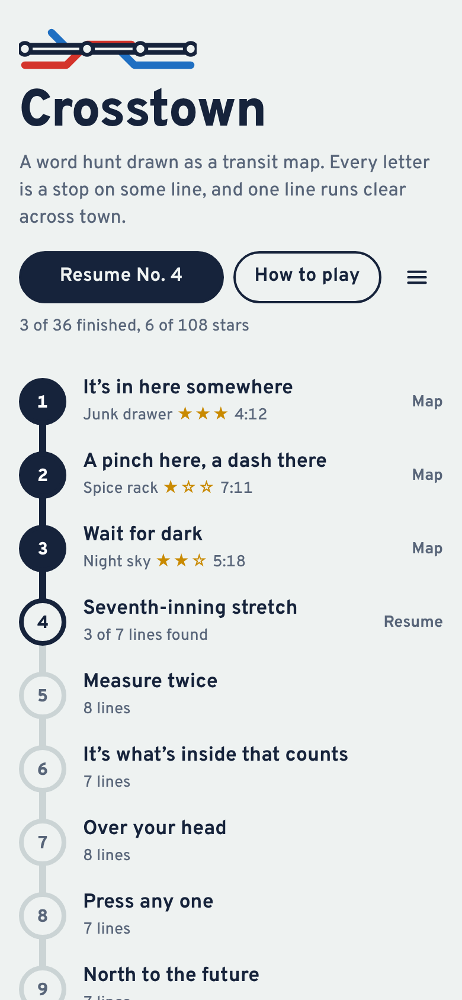
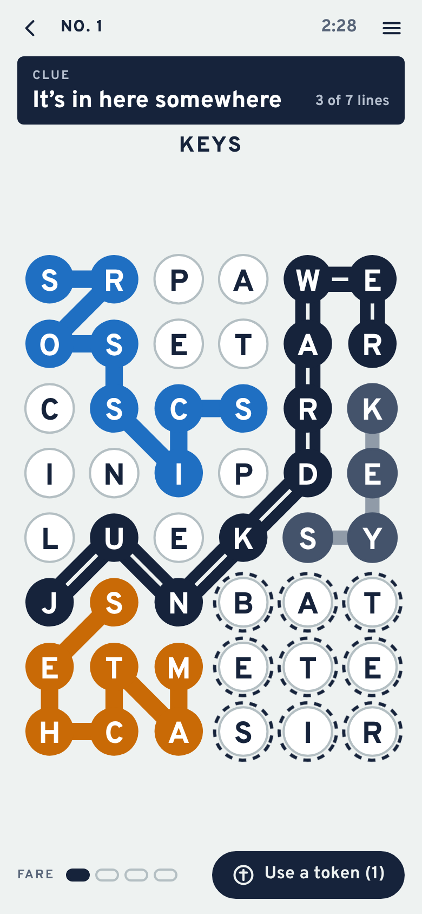
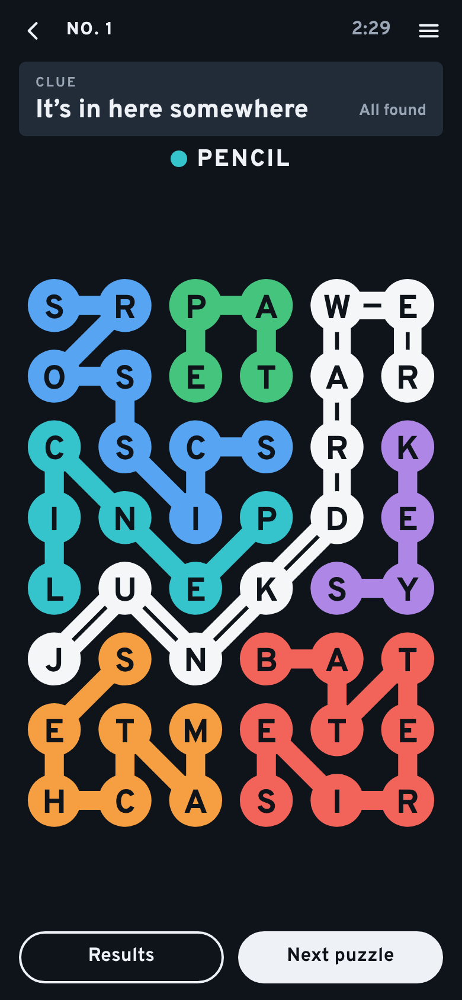

# Crosstown

**Play it: [crosstown.junkdrawer.works](https://crosstown.junkdrawer.works/)**

**A word hunt drawn as a transit map.** Every letter is a stop, and each theme word you find becomes its own coloured line. One word, the Crosstown, names the theme and runs from one edge of the map to the opposite edge. When you're done, every stop is on a line and the board looks like a subway map.

<p align="center">
  
  &nbsp;
  
  &nbsp;
  
</p>

## How it plays

- **Find the lines.** Trace a word from stop to stop in any direction, diagonals included. Drag across the letters, or tap them one at a time and tap the last one again. Arrow keys and Enter work too.
- **Every letter is used once.** Each stop belongs to exactly one line, and lines never cross, so the last few words are whatever is left.
- **The Crosstown.** One word names the theme and starts and ends on opposite edges of the map.
- **Detours earn fare.** Any other word of four letters or more is a detour. Four letters earn 1 fare, five earn 2, six earn 3, seven or more earn 4, and every 4 fare becomes a token.
- **A token is a hint.** It rings the stops of a line you haven't found. A second token on the same line draws its route and marks where it starts.
- **Three stars.** One for finishing, one for spending no tokens, one for finding the Crosstown before any other line.
- **Clock and night service.** Two options: time each puzzle and keep your best, and hide the clue until you find your first line.
- No account and no server. Your progress stays in your browser. It works offline and installs to a phone's home screen.

## The puzzles

The 36 puzzles are written for this game: the themes, the clues and the word lists are in `tools/themes.mjs`, and nothing is taken from any other game's puzzles. `node tools/make-puzzles.mjs` picks a set of words from each theme that fills the 48 stops exactly, packs them into the grid, and keeps the tidiest layout it finds: no word can be spelled through another line's stops, and no two lines cut across each other. `npm test` then checks every board again without trusting the tool.

To add a puzzle, add a theme (a clue, the Crosstown, and a dozen or so words of four letters or more) and run the tool.

## Running it

It's a static site: plain HTML, CSS and JavaScript, with no build step.

```sh
npx serve .                   # or any static file server, then open the printed address
npm install                   # only for the tools and tests below
npm test                      # checks every puzzle, then plays one in Chromium through the real page (needs Playwright)
node tools/make-puzzles.mjs   # lays the puzzles out again from tools/themes.mjs
node tools/screenshots.mjs    # redraws docs/*.png and og.png
node tools/make-icons.mjs     # redraws the PNG icons from icon.svg
npm run build                 # dist/crosstown.html, the whole game in one file
```

To put it online with GitHub Pages: **Settings → Pages → Build and deployment → Deploy from a branch**, then pick `main` and `/ (root)`. The `CNAME` file gives it its own address, which needs a DNS record pointing `crosstown` at `markjf99702.github.io`.

### Files

- `js/app.js`: the list, the map, tracing with a finger, mouse or keyboard, tokens, and what's saved.
- `js/board.js`: the grid's geometry, shared by the game, the puzzle tool and the tests.
- `js/rules.js`: fare, stars and the clock's arithmetic.
- `js/puzzles.js`: the boards, written by `tools/make-puzzles.mjs`. Don't edit it by hand.
- `tools/themes.mjs`: where every puzzle starts.
- `tools/play.mjs`: a small static server and the hands that drag and tap for the tests and screenshots.
- `test/unit.test.mjs`, `test/e2e.mjs`: the puzzle checks and the play-through.
- `fonts/`: Overpass (SIL Open Font License), served from here so nothing loads from elsewhere.
- `sw.js`: keeps a copy for using offline.

The words that count as detours come from [SCOWL](http://wordlist.aspell.net/) by way of the `wordlist-english` package, used only when the puzzles are made.
